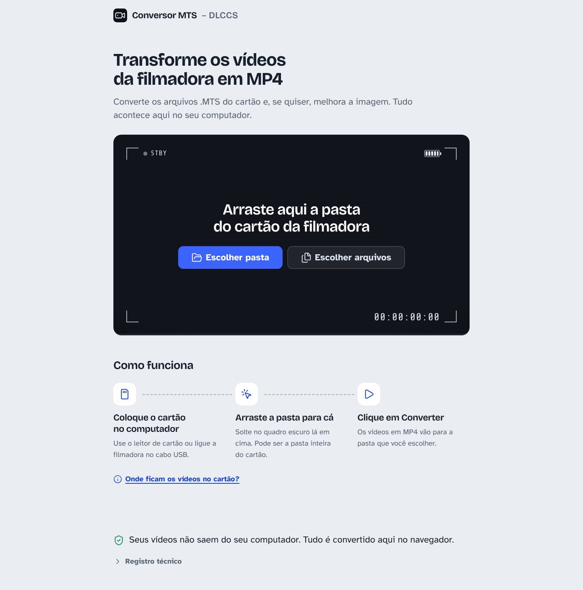

# Conversor MTS - DLCCS

Aplicação web que converte os vídeos **.MTS / .M2TS** (formato AVCHD das filmadoras Sony e Panasonic) em **MP4**, com melhoria de imagem opcional. Tudo acontece no navegador, com [ffmpeg.wasm](https://github.com/ffmpegwasm/ffmpeg.wasm): **nenhum vídeo é enviado para servidor nenhum**.

Foi feita para quem não é técnico. A página tem um único caminho, com um botão principal em cada etapa:

1. **Vazio:** arraste a pasta do cartão para o visor (ou use "Escolher pasta").
2. **Pronto para converter:**
   - os vídeos aparecem com miniatura, agrupados pelo dia da gravação;
   - escolha **Melhorar qualidade** ou **Conversão rápida**;
   - opcionalmente, veja a **Prévia da melhoria** (antes/depois com slider);
   - escolha a pasta de destino.
3. **Convertendo:** o visor vira o painel de progresso, com o tempo restante estimado.
4. **Concluído:** resumo, música de comemoração e confete. Os vídeos ficam salvos na pasta escolhida ou prontos para baixar.



## Como rodar

Requer Node.js 20 ou mais recente.

```bash
npm install      # instala e copia o motor ffmpeg para public/ffmpeg/
npm run dev      # http://localhost:5173
```

Outros comandos:

| Comando | O que faz |
| --- | --- |
| `npm run build` | Verifica os tipos (TypeScript) e gera `dist/` |
| `npm run preview` | Serve o `dist/` com os mesmos headers da produção |
| `npm test` | Testes unitários (Vitest): argumentos do ffmpeg, nomes de arquivo, estimativas |
| `npm run fixtures` | Gera vídeos de teste 1080i com áudio AC-3 em `test-fixtures/` (precisa do `ffmpeg` instalado) |
| `npm run test:e2e` | Testes no Chromium com Playwright: pasta, miniaturas, prévia, conversão nos dois modos e verificação de vídeo e áudio dos MP4 |
| `SCREENSHOTS=1 npx playwright test screenshots` | Screenshots de revisão de todos os estados em 1440/1024/390 px, claro e escuro |
| `npm run icons` | Regera os PNGs do PWA a partir dos SVGs |

Os arquivos do motor (`public/ffmpeg/st` e `public/ffmpeg/mt`) **não vão para o git**. Eles são copiados de `node_modules` automaticamente no `postinstall` e no `prebuild`.

## Publicar na Vercel

1. Suba o repositório para o GitHub.
2. Em [vercel.com/new](https://vercel.com/new), clique em **Import** no repositório.
3. Framework preset: **Vite**. Build command `npm run build`, output `dist`: a Vercel detecta sozinha.
4. **Não é preciso nenhuma variável de ambiente.** Clique em **Deploy**.

O `vercel.json` já configura os headers de isolamento em todas as rotas e o cache longo (`immutable`) para `/ffmpeg/*` e `/assets/*`.

## Por que os headers COOP/COEP são necessários

O motor multithread do ffmpeg.wasm usa `SharedArrayBuffer`, e os navegadores só liberam esse recurso em páginas com **isolamento de origem**:

```
Cross-Origin-Opener-Policy: same-origin
Cross-Origin-Embedder-Policy: require-corp
```

O preço do isolamento é que a página não pode carregar nada de outro domínio sem permissão explícita. Por isso:

- as fontes são auto-hospedadas (`@fontsource`);
- os ícones (Lucide) entram no build;
- o motor ffmpeg é servido do próprio site, em `/ffmpeg/`.

Se o isolamento não estiver ativo, o app usa automaticamente o motor single-thread. Ele funciona do mesmo jeito, só que mais devagar. A mesma troca acontece se o multithread falhar ou travar por mais de 30 s, e fica anotada no "Registro técnico".

## Navegadores suportados

| Navegador | Suporte |
| --- | --- |
| **Google Chrome / Microsoft Edge** (computador) | Completo e recomendado: salva direto numa pasta, motor multithread, tela acesa durante a conversão |
| Firefox | Deve converter (não coberto pelos testes automáticos); os vídeos são baixados para a pasta Downloads |
| Safari (macOS) | Deve converter (não coberto pelos testes automáticos); os vídeos são baixados para a pasta Downloads |
| Celular e tablet | Funciona, mas com aviso: a conversão é pesada para o aparelho |

Os arquivos são lidos direto do disco (`WORKERFS`), sem copiar o vídeo inteiro para a memória, então vídeos grandes funcionam. Se o navegador não suportar isso, o app copia o arquivo para a memória. Só nesse caso aparece o aviso para vídeos acima de 1,5 GB.

## Como funciona por dentro

- `src/ffmpeg.ts`:
  - instância única do motor;
  - pré-carga em segundo plano quando o navegador fica ocioso;
  - escolha multithread/single-thread, vigia de travamento e `terminate()` no botão "Parar".
- `src/args.ts`: argumentos exatos do ffmpeg. No modo Melhorar a ordem é desentrelaçar (`bwdif`) → ruído (`hqdn3d`) → escala (`lanczos`) → nitidez (`unsharp`) → cor (`eq`) → `yuv420p`.
- `src/probe.ts`: duração e miniatura numa passada, mais os quadros da prévia.
- `src/queue.ts`: fila. Um vídeo por vez; erro em um não para os outros. O progresso vem do log (`Duration` e `time=`).
- `src/estimate.ts`: tempo restante pela velocidade medida (média móvel), calibrado para as próximas conversões.
- `src/files.ts`, `src/save.ts`, `src/naming.ts`, `src/settings.ts`: pastas, salvamento, nomes (nunca sobrescreve: usa "(2)") e preferências.
- `src/ui/` e `src/styles/`: componentes e CSS por componente, com tokens em `styles/tokens.css`.

O áudio é sempre preservado (inclusive 5.1) e convertido para AAC.

## Créditos

- Motor: [ffmpeg.wasm](https://github.com/ffmpegwasm/ffmpeg.wasm) (FFmpeg, LGPL/GPL).
- Fontes: Bricolage Grotesque, Atkinson Hyperlegible e Share Tech Mono (SIL Open Font License).
- Ícones: [Lucide](https://lucide.dev) (ISC).
- Música de conclusão: trecho fornecido pelo autor do projeto ("Toca a música do Fox Sports", Matheus S. Andrade), usado em contexto pessoal.
